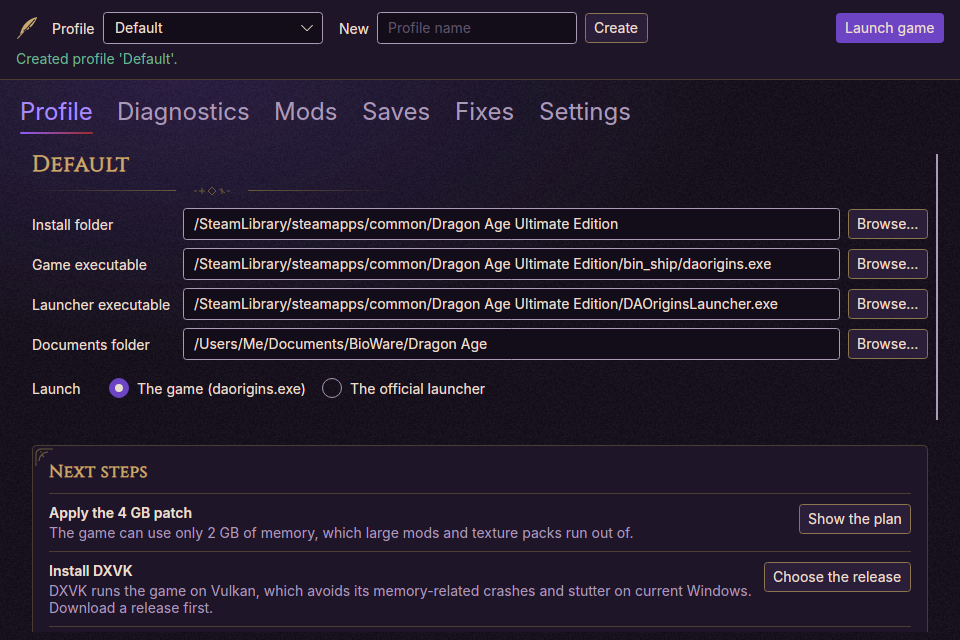
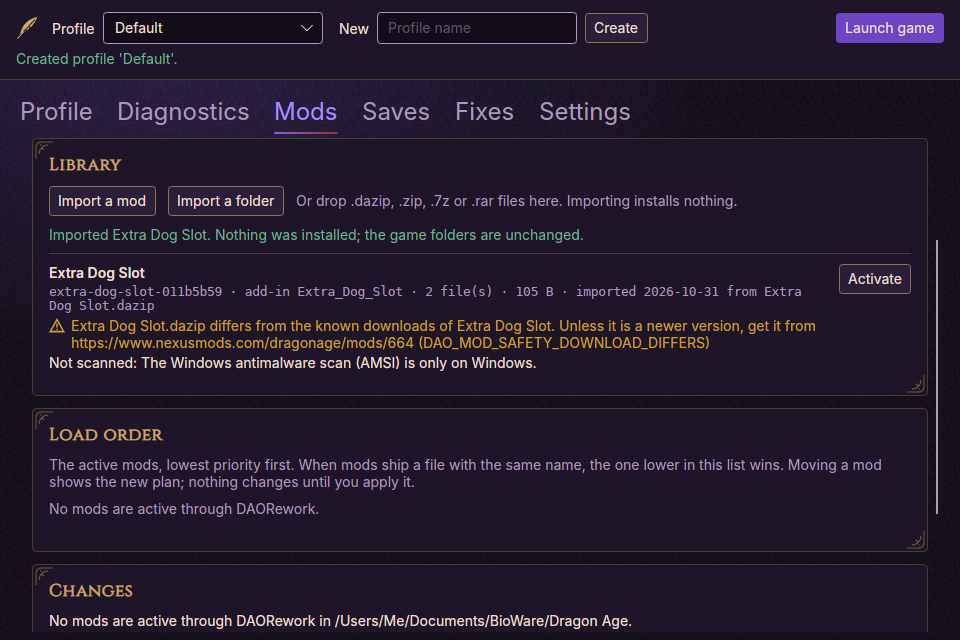
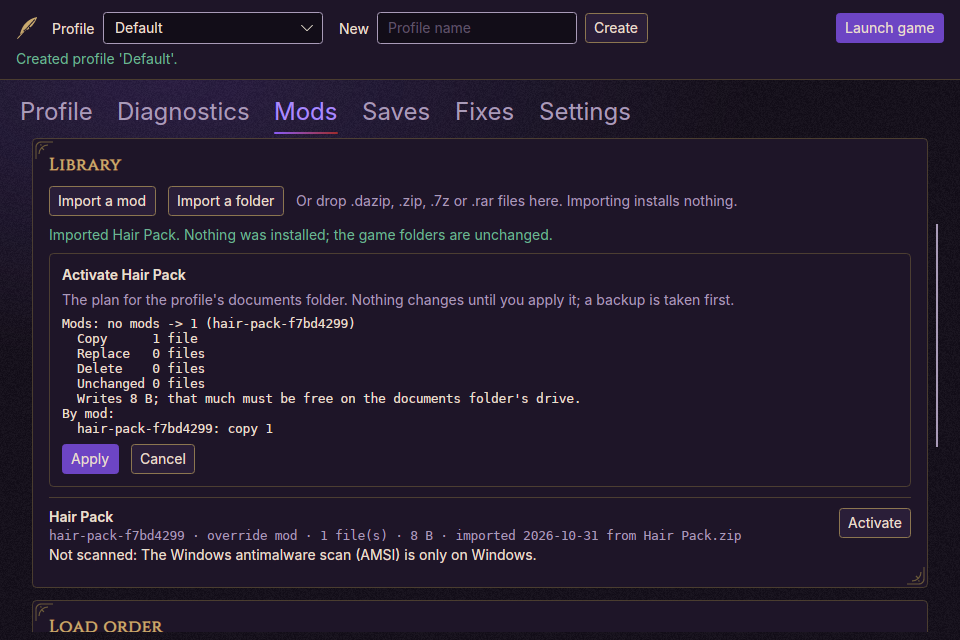
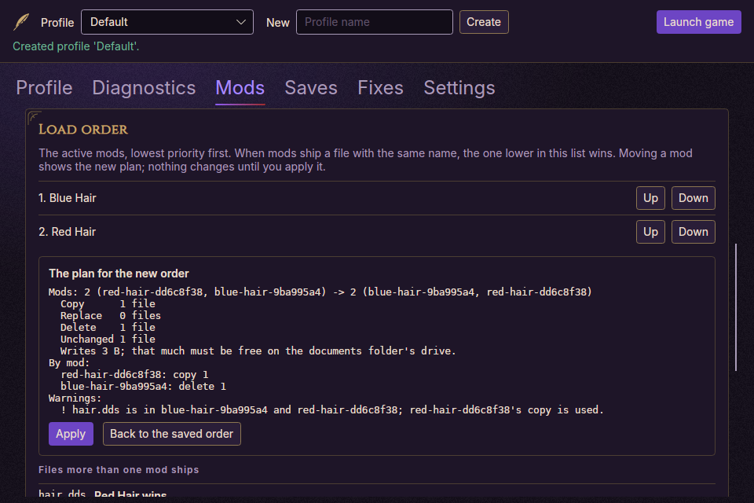
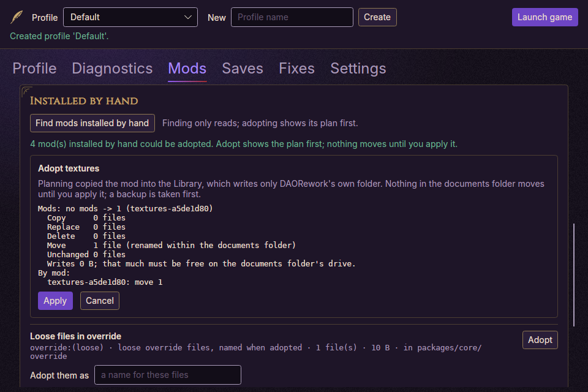
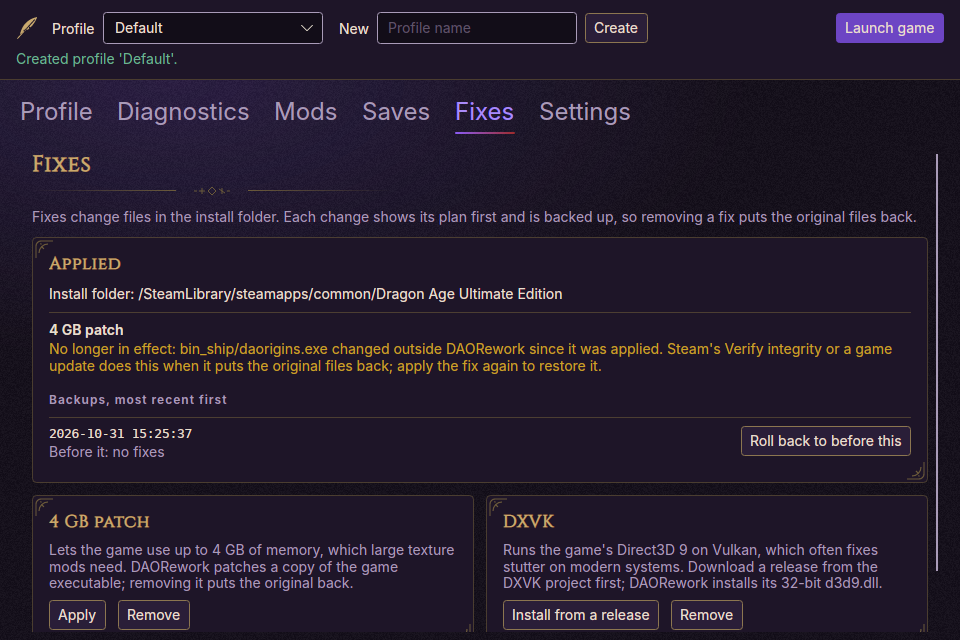
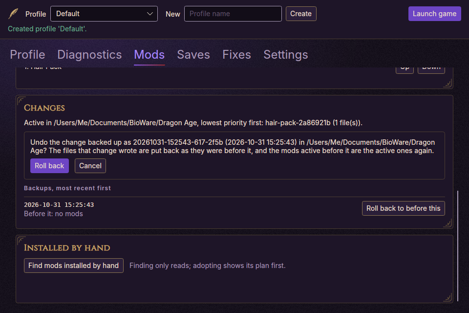
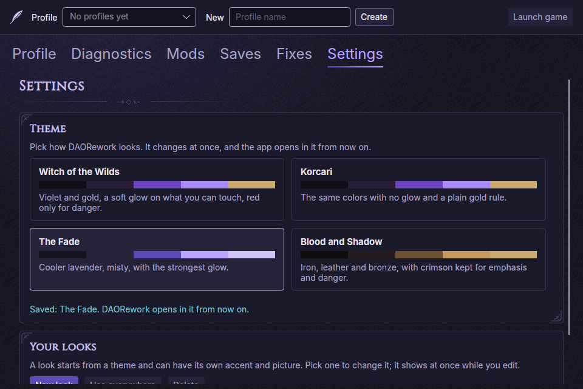
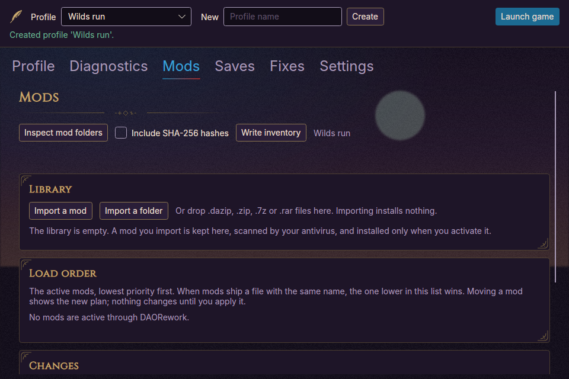

# DAORework

DAORework is a launcher, diagnostics tool and mod/profile manager for Dragon Age: Origins,
with a long-term experimental runtime research track. It is a community project and is not
affiliated with BioWare or Electronic Arts.

This project does **not** include Dragon Age: Origins assets, BioWare/EA code, game content or
community mod content. You must own and install the game separately; DAORework only reads files
already on your machine. See [docs/LEGAL_BOUNDARIES.md](docs/LEGAL_BOUNDARIES.md).

## Download

Windows builds are on the [Releases page](https://github.com/arastella625/DAORework/releases), and the project
website, <https://daorework.dilly-world.net/>, lists each release's checksum. Unzip anywhere and run
`DAORework.exe` for the window or `dao.exe` for the command line; both are self-contained, so no .NET install is
needed. Profiles, the mod library, reports and backups go to `%LOCALAPPDATA%\DAORework`. Your game and Documents
folders change only when you activate a mod or apply a fix, always after showing the plan and taking a backup you can
roll back to.

The executables are not code-signed (a signing certificate would carry the author's personal details), so Windows
SmartScreen may warn on first run: **More info**, then **Run anyway**. Instead, every release can be checked two ways:

- **Checksum:** compare `Get-FileHash DAORework-<version>-win-x64.zip` in PowerShell with the release's `.sha256` file.
- **Build attestation:** `gh attestation verify DAORework-<version>-win-x64.zip --repo arastella625/DAORework`
  proves the zip was built by this repository's release workflow from a published commit, untouched since (the same
  works for `DAORework.exe` and `dao.exe`).

## What it does



- **Takes over the mods you already installed by hand**, in `override` and `AddIns`, without reinstalling them.
  Official DLC is never touched.
- **Installs mods safely.** Import a `.dazip`, `.zip`, `.7z` or `.rar` (or drop it on the window). Activating shows
  exactly what will be copied, replaced or removed first, takes a backup, and can be rolled back.
- **Shows conflicts.** For every file two mods share, whose copy the game uses, and lets you reorder them.
- **Checks every mod.** Programs inside a mod are named and never installed, your own antivirus scans every mod before
  it is kept, and a download that differs from the known official one is pointed out.
- **Applies the 4 GB patch and DXVK**, and notices when Steam's Verify integrity has undone them.
- **Diagnoses your install** and suggests next steps, each with its button.
- **Backs up your saves**, and launches the game.

Nothing is downloaded and nothing is sent anywhere: DAORework only works with files already on your computer.

## Status

Phases 1 and 2 of the [roadmap](docs/ROADMAP.md) are done. Phase 1 (companion v1, release 0.1.0) is read-only: the
window, install and documents detection, the full diagnostic rule set, support bundles, save backups and the
known-items catalog. Phase 2 (mod manager, release 0.2.0) writes, always behind a plan, a backup and rollback: a mod
library, mod activation, and the 4 GB patch and DXVK as managed fixes, with a test suite that kills DAORework at
every write and proves each change still ends fully before or fully after. Both are verified on a real Steam
install; GOG and EA App installs still need a real run ([#5](https://github.com/arastella625/DAORework/issues/5)).
Phase 2.5 (release 0.3.0, the first public one) puts all of it in the window and adds adopting the mods you installed
by hand, `.7z` and `.rar` import, the load order and its conflicts, and mod safety checks (programs never installed,
your antivirus scans every mod, downloads compared with the known official ones). Phase 3, the file-format toolkit,
is next.

## How it is built

DAORework is designed and directed by Amber Rastella, a C# developer, with an AI coding assistant (Anthropic's Claude)
writing much of the code. She sets the standards every change must pass and makes the calls that affect your files and
safety; the architecture rules in [docs/ENGINEERING_STANDARDS.md](docs/ENGINEERING_STANDARDS.md), the decisions in
[docs/adr](docs/adr), unit and screenshot tests, and a fault-injection suite that kills DAORework at every write all
gate each change, and every release is checked on a real install ([docs/testing](docs/testing)). Why it is built this
way, the research on AI and programming, and the water question are in
[docs/HOW_IT_IS_BUILT.md](docs/HOW_IT_IS_BUILT.md).

## Documentation

| Document | Purpose |
|---|---|
| [docs/SDD.md](docs/SDD.md) | Software Design Document: architecture, patterns, domain model |
| [docs/ENGINEERING_STANDARDS.md](docs/ENGINEERING_STANDARDS.md) | Mandatory coding rules, PR checklist, Definition of Done |
| [docs/ROADMAP.md](docs/ROADMAP.md) | Phase-gated project plan with task IDs and exit gates |
| [docs/CURRENT_STATE_AUDIT.md](docs/CURRENT_STATE_AUDIT.md) | Gap analysis of the code against the SDD, with the Phase 0 re-run |
| [docs/adr/](docs/adr/) | Architecture Decision Records |
| [docs/LEGAL_BOUNDARIES.md](docs/LEGAL_BOUNDARIES.md) | Legal and IP boundaries |
| [CONTRIBUTING.md](CONTRIBUTING.md) | Workflow: issues, branches, PRs, labels, the project board and verify-before-PR |
| [CHANGELOG.md](CHANGELOG.md) | Notable changes, Keep-a-Changelog format |
| [LICENSE](LICENSE) | MIT ([ADR-0008](docs/adr/0008-project-license-mit.md)); ported code is listed in [THIRD-PARTY-NOTICES.md](THIRD-PARTY-NOTICES.md) |

## The window

`DAORework.App` is the desktop application ([ADR-0010](docs/adr/0010-gui-avalonia-in-phase-1.md)):

```bash
dotnet run --project src/DAORework.App
```

Create a profile in the header: DAORework finds your install and documents folder, checks them, and lists next steps
on the **Profile** tab. The **Mods** tab holds your library, the load order, your changes and backups, and the mods you
installed by hand; **Fixes** applies the 4 GB patch and DXVK; **Saves** backs up your saves; **Settings** picks a theme
or your own look. Every change shows its plan before anything is written, and **Launch game** starts the game. The
window and the CLI below use the same use cases and app-data folders, so the two can be mixed freely.

| | |
|---|---|
|  |  |
| **Library:** import by button or drop; each mod's antivirus result and program files | **Activate:** the plan first, nothing written until Apply |
|  |  |
| **Load order:** whose copy of a shared file wins, reordered through a plan | **Adopt:** a mod you installed by hand, taken over without reinstalling |
|  |  |
| **Fixes:** the 4 GB patch and DXVK, and when Steam's Verify integrity undid one | **Changes:** any change rolled back from its backup, asked once more |
|  |  |
| **Themes:** four dark themes | **Your looks:** your own accent and background picture |

*Screenshots come from the automated window tests, with made-up mods.*

## What the command line does

- Detects Dragon Age: Origins installations: Steam libraries on any drive, GOG Galaxy and EA App registrations, the usual folders, or a folder you name with `detect --path`
- Finds the documents folder, including a OneDrive-redirected Documents folder, and warns when saves sit somewhere else than the profile says
- Creates named runtime profiles (install directory, executables, documents folder, launch target)
- Diagnoses a profile and writes a JSON report with stable `DAO_*` codes
- Launches the game or the official launcher from a profile; a Steam install is started through Steam
  ([ADR-0022](docs/adr/0022-launching-steam-installs-through-steam.md))
- Summarizes the `override` and `AddIns` mod folders and writes a JSON inventory, optionally with SHA-256 hashes
- Recognizes known community fixes and mods from a [catalog](catalog/README.md) kept in the repository: DXVK with its version (and a 64-bit DLL the game cannot load), the 4 GB patch, and known-incompatible combinations
- Manages mods (`mods import`, `library`, `activate`, `deactivate`, `adopt`, `status`, `rollback`, `recover`), fixes (`fixes apply`, `remove`, `status`, `rollback`, `recover`) and save backups (`saves backup`, `list`), each change behind a plan, a backup and rollback
- Keeps the experimental runtime behind an explicit placeholder that fails on purpose

The CLI is the scripting surface; the window above does the same things with buttons and pickers.

## Requirements

- .NET SDK 10 (the exact version is pinned in `global.json`)
- Windows for detection and launching. The code builds and its tests run on Linux and macOS too.
- PowerShell 7 for the two gate scripts in `scripts/`

## Build and test

```bash
dotnet build DAORework.sln
dotnet test DAORework.sln
```

## Commands

Run the CLI from the repository root with `dotnet run --project src/DAORework.Cli -- <command>`.
`--help` works on every command and group.

```text
$ dotnet run --project src/DAORework.Cli -- --help
COMMANDS:
    detect      Detect Dragon Age: Origins installations
    init        Create a runtime profile, pre-filled from the best detected install
    profiles    List saved runtime profiles
    profile     Show or edit a runtime profile
    diagnose    Validate a saved runtime profile and write a diagnostic report
    launch      Launch Dragon Age: Origins using a saved profile
    mods        Inspect the mod folders, import mods into the library, and activate them
    fixes       Apply managed fixes to the game install folder, with a backup: the 4 GB patch and DXVK
```

A typical first session, with the profile name defaulting to `Default` where it is omitted:

```bash
dotnet run --project src/DAORework.Cli -- detect
dotnet run --project src/DAORework.Cli -- init Default
dotnet run --project src/DAORework.Cli -- profile set-path Default install "D:\SteamLibrary\steamapps\common\Dragon Age Ultimate Edition"
dotnet run --project src/DAORework.Cli -- profile show Default
dotnet run --project src/DAORework.Cli -- diagnose Default
dotnet run --project src/DAORework.Cli -- launch Default
dotnet run --project src/DAORework.Cli -- mods inspect Default
dotnet run --project src/DAORework.Cli -- mods inventory Default --hash
```

`mods import <path>` adds a downloaded mod (`.dazip`, `.zip`, `.7z`, `.rar` or extracted folder) to DAORework's own library
without installing it, after your antivirus has scanned it (a mod it reports is refused), and `mods library` lists
the library. Programs inside a mod are named and never installed. A download of a mod the catalog knows is compared
with the official downloads it records, and a copy that differs from all of them is pointed back to the mod's page.
From there, with `-p <profile>` choosing the
documents folder:

```bash
dotnet run --project src/DAORework.Cli -- mods activate <mod id> [<mod id> ...] --dry-run --files  # show the plan only
dotnet run --project src/DAORework.Cli -- mods activate <mod id>      # shows the plan, then asks
dotnet run --project src/DAORework.Cli -- mods deactivate <mod id>
dotnet run --project src/DAORework.Cli -- mods status                  # what is active, and the backups to roll back to
dotnet run --project src/DAORework.Cli -- mods rollback                # undo the last change from its backup
dotnet run --project src/DAORework.Cli -- mods recover --finish        # or --rollback, after a change was cut short
dotnet run --project src/DAORework.Cli -- mods adopt --dry-run         # mods installed by hand that DAORework could take over
dotnet run --project src/DAORework.Cli -- mods adopt "override:Better Hair" addin:Extra_Dog_Slot   # shows the plan, then asks
```

Every change backs up what it will replace first, and a file DAORework did not put there is never
overwritten: the plan is blocked instead. `--yes` applies without asking; without it, a script is refused.

`fixes` applies well-known fixes to the game's install folder the same way: plan first, then a backup,
then the change, and `fixes remove` or `fixes rollback` puts the original files back. There are two: the
4 GB patch, which lets the 32-bit game use 4 GB of memory, and DXVK, which runs the game's Direct3D 9 on
Vulkan, from a release you download from [its GitHub releases](https://github.com/doitsujin/dxvk/releases):

```bash
dotnet run --project src/DAORework.Cli -- fixes apply laa --dry-run   # show the plan only
dotnet run --project src/DAORework.Cli -- fixes apply laa             # patch bin_ship\daorigins.exe, after a backup
dotnet run --project src/DAORework.Cli -- fixes status                # what is applied, and whether Steam has undone it
dotnet run --project src/DAORework.Cli -- fixes remove laa            # put the original exe back
dotnet run --project src/DAORework.Cli -- fixes apply dxvk "C:\Users\you\Downloads\dxvk-2.3.tar.gz"   # its x32\d3d9.dll
dotnet run --project src/DAORework.Cli -- fixes remove dxvk
```

DXVK replaces a `d3d9.dll` already in `bin_ship` only when it is DXVK too (an upgrade or downgrade, with
the old one kept so `fixes remove dxvk` puts it back); ReShade or any other wrapper blocks the plan.

Close the game first. DAORework never asks for administrator rights, so an install under
`Program Files` needs DAORework itself run as administrator (a Steam library elsewhere does not).

`saves backup Default` copies your saves into DAORework's own folder (keeping the newest 10 by
default, `--keep N` to change it) and `saves list Default` shows them; the saves folder is never changed.

For a bug report, `dotnet run --project src/DAORework.Cli -- support-bundle Default` writes one zip
with the profile, diagnostics, mod inventory and recent logs, with your user name replaced by `<user>`.

`profile` has `list`, `show`, `set-target <profile> <Game|OfficialLauncher>` and
`set-path <profile> <install|game|launcher|documents> <path>`. `profiles` is a shortcut for
`profile list`.

Exit codes: `0` success, `1` an expected failure (for example a profile that does not exist),
`2` invalid usage, `70` an unexpected error, which is also written to the log.

## Local app data

Profiles, reports and logs are written under `%LOCALAPPDATA%\DAORework` (on Linux and macOS,
the local application data folder that .NET reports):

```text
profiles/       one {name}.json per runtime profile
reports/        dao-runtime-report-*.json and dao-mod-inventory-*.json
mod-profiles/   reserved for Phase 2
logs/           one file per day
```

Every JSON document carries a `schemaVersion`. Older documents are migrated when they are
loaded, and every write is atomic, so an interrupted save never leaves a half-written file.

## Solution structure

```text
DAORework/
├── src/
│   ├── DAORework.Core/              # Domain: value objects, models, diagnostic codes (no I/O)
│   ├── DAORework.Application/       # Use cases, ports and diagnostic rules
│   ├── DAORework.Infrastructure/    # Adapters: file system, process launching, JSON persistence
│   ├── DAORework.Cli/               # Spectre.Console.Cli commands and renderers
│   └── DAORework.App/               # Avalonia window: one view + view model per page
├── tests/
│   ├── DAORework.Core.Tests/            # Value objects and domain rules (pure)
│   ├── DAORework.Application.Tests/     # Use cases and rules on a mock file system
│   ├── DAORework.Infrastructure.Tests/  # Adapters against a temp directory, migrations
│   ├── DAORework.Architecture.Tests/    # Dependency and forbidden-API rules (NetArchTest)
│   ├── DAORework.Cli.Tests/             # Commands end to end, exit codes
│   └── DAORework.App.Tests/             # Pages rendered headlessly, screenshots, view-model flows
├── docs/                            # SDD, standards, roadmap, audit, ADRs
├── scripts/                         # CI gates and the owner's real-install check
├── .github/                         # CI workflow, PR and issue templates
├── Directory.Build.props            # Shared build settings: warnings as errors, analyzers
├── Directory.Packages.props         # Central package versions
└── DAORework.sln
```

The layering and the rules behind it are in [docs/SDD.md](docs/SDD.md) §4 and are enforced
by the architecture tests.

## Contributing

Read [CONTRIBUTING.md](CONTRIBUTING.md) first. One task, one branch, one PR; a task is shown
working before its PR is opened. The next tasks are in [docs/ROADMAP.md](docs/ROADMAP.md).

## License

Free, with its source public, under the [PolyForm Noncommercial License 1.0.0](LICENSE)
([ADR-0020](docs/adr/0020-license-noncommercial.md)): you may use, change and share DAORework, and build on it, for
any noncommercial purpose, as long as you pass on the license and its copyright notice. Nobody may sell it. Dragon
Age: Origins is the property of BioWare and Electronic Arts; this project ships none of it.
